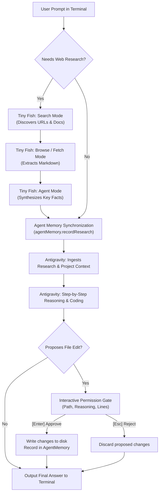

# 🌌 Ingressus AI — Dual-Agent Terminal Development Environment

> **Tiny Fish (Web Research Agent) + Antigravity (Coding Agent) working in unison inside an interactive React/Ink Terminal UI.**

Ingressus AI pairs autonomous live-web research with deep reasoning and coding capabilities. It features real-time agent memory synchronization, a human-in-the-loop file editing permission gate, and full transparency across every web and coding operation.

---

## ✨ Features

- **🤝 Dual-Agent Orchestration**:
  - **Tiny Fish**: Live web research with 4 discrete modes — `Search`, `Browse`, `Fetch`, and `Agent`.
  - **Antigravity**: Consumes research findings via synchronized memory, reasons step-by-step, and crafts production-ready code.
- **🧠 Synchronized Memory (`AgentMemory`)**: Tracks visited websites, extracted research findings, and edited files across the entire multi-turn conversation.
- **🛡️ Human-in-the-Loop File Permissions**: When the agent wants to modify or create files on your machine, an interactive approval prompt appears with the target path, line count, and reasoning. Hit **`[Enter]`** to apply or **`[Esc]`** to reject.
- **📺 Live Transparent Execution**: No vague `Cooking...` spinners. Every operational phase is streamed live to your terminal:
  - 🔍 `[SEARCH]` — Querying web engines for fresh documentation and solutions.
  - 🌐 `[BROWSE]` — Navigating live web pages.
  - ⚡ `[FETCH]` — Extracting clean markdown from target sites.
  - 🤖 `[AGENT]` — Synthesizing facts and extracting structured context.
  - 📥 `[CONTEXT]` — Ingesting research into Antigravity’s active context.
  - 💡 `[REASONING]` — Antigravity's architectural planning and code drafting.
- **⏹️ Claude-Style `[Esc] to Stop`**: Hit **`Esc`** at any point while an agent is thinking or researching to immediately cancel the operation.
- **🎯 Tau-Style Model Selector (`/models`)**: Interactive arrow-key navigation with real-time fuzzy filtering over 20+ Gemini, Claude, and Flash models.
- **🌐 Universal Browser Launcher (`/login`)**: Direct process spawning that auto-detects Edge, Chrome, Brave, Firefox, and Opera on Windows for seamless Google OAuth authentication.
- **⚡ Flicker-Free Terminal UI**: Clean React + Ink architecture with static inverse block cursors and memoized renders.

---

## 🚀 Installation & Running

### Option 1: Global CLI (Run from Any Project Directory)

Install globally once:
```powershell
npm install -g "D:\Ingressus AI"
```

Then navigate to **any project directory** on your computer and start:
```powershell
cd D:\your-project
ingressus
```

### Option 2: Local Run

```powershell
cd "D:\Ingressus AI"
npm install
npm start
```

---

## ⚡ Available Commands

| Command | Action |
|---|---|
| `<prompt>` | Triggers the dual-agent workflow: research on the web with Tiny Fish → plan & code with Antigravity → propose file edits. |
| `/login [browser]` | Google OAuth PKCE sign-in for Antigravity (e.g. `/login`, `/login chrome`, `/login edge`). |
| `/models` or `/model` | Opens the interactive arrow-key model selector. |
| `/memory` | Displays current synchronized agent memory (visited sites, findings, and edited files). |
| `/search <query>` | Standalone web search via Tiny Fish MCP. |
| `/fetch <url>` | Direct page content extraction to clean markdown. |
| `/wallet` | Inspects your Tiny Fish credit balance and rates. |
| `/clear` | Clears conversation history and terminal output. |
| `/help` | Displays the interactive command guide. |
| `Esc` | Immediately aborts any running agent task. |
| `/exit` or `q` | Exits the application. |

---

## 🔄 Dual-Agent Workflow Lifecycle



---

## 📁 Project Structure

```
D:\Ingressus AI\
├── bin/
│   └── ingressus.js              # Global CLI executable launcher (npx.cmd / tsx)
├── src/
│   ├── cli.tsx                   # Main React/Ink TUI application & lifecycle
│   ├── agent/
│   │   ├── coordinator.ts        # Dual-agent workflow orchestrator (Tiny Fish + Antigravity)
│   │   └── memory.ts             # Shared agent memory (visited sites, findings, edited files)
│   ├── components/
│   │   ├── FilePermissionPrompt.tsx  # Interactive [Enter]/[Esc] file approval gate
│   │   ├── IngressusWordmark.tsx     # Animated metallic block logo
│   │   ├── MinimalWelcome.tsx        # Compact header and session banner
│   │   ├── ModelSelector.tsx         # Interactive Tau-style model picker
│   │   ├── PromptBox.tsx             # Input box with [Esc] to stop and history
│   │   └── TinyFishOutput.tsx        # Live stream renderer for research, reasoning & loading
│   ├── antigravity/
│   │   ├── auth.ts               # Google OAuth PKCE token exchange & refresh
│   │   ├── code_assist.ts        # Code Assist envelope wrapping & SSE streaming
│   │   ├── constants.ts          # Endpoints, client IDs, and user-agents
│   │   ├── login.ts              # Interactive OAuth login flow
│   │   ├── models.ts             # Model catalog (Gemini 4 Argon, 3.8 Flash, Claude 5.5/4.6)
│   │   └── transport.ts          # API transport with 429 quota rotation
│   ├── commands/
│   │   ├── handlers.ts           # Slash command dispatcher
│   │   └── registry.ts           # Command definitions and metadata
│   ├── services/
│   │   └── tinyfish.ts           # Tiny Fish MCP integration (search, fetch, browse)
│   └── utils/
│       └── browser.ts            # Windows multi-browser detector & launcher
├── package.json
└── tsconfig.json
```

---

## 🛡️ License

MIT License. Built for seamless developer collaboration with autonomous AI agents.

